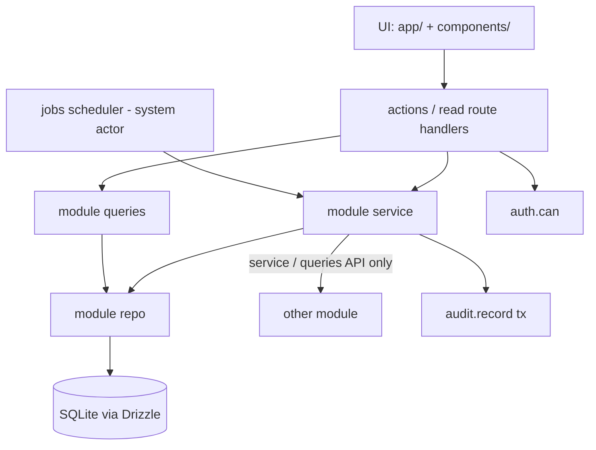
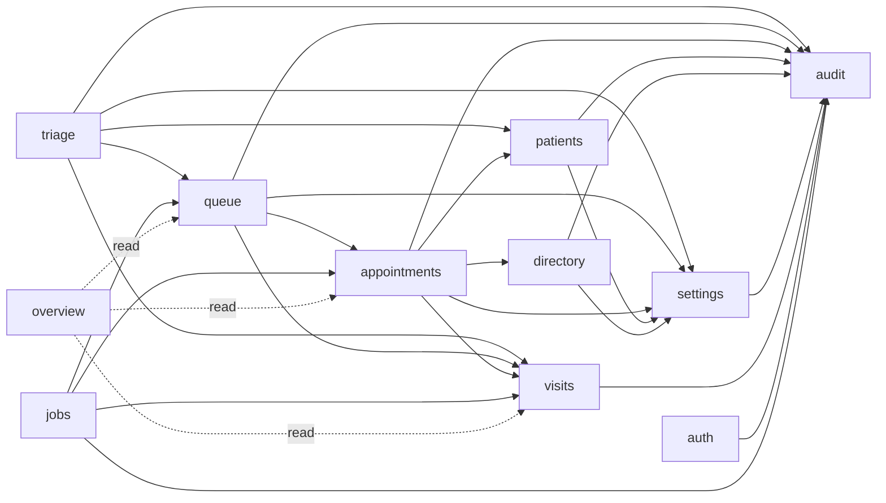
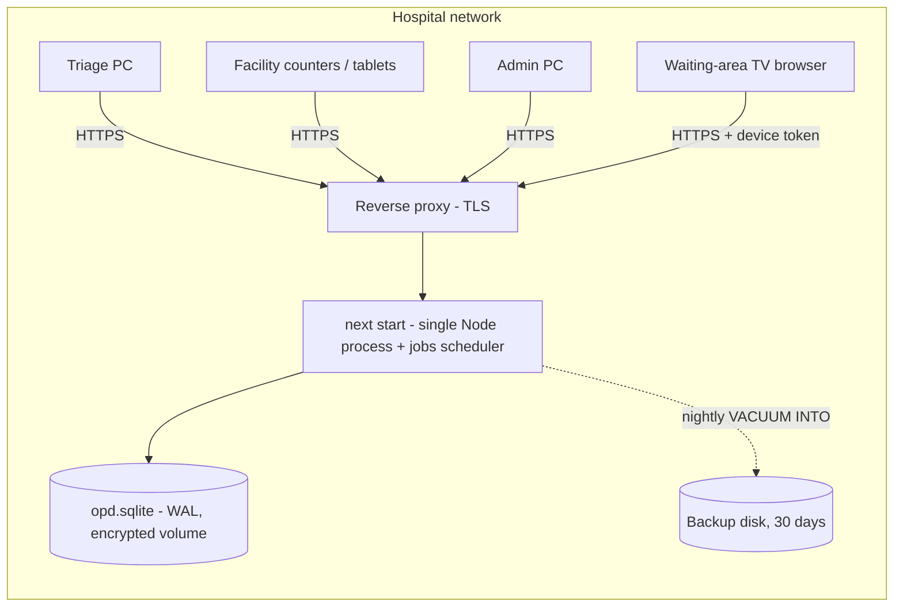
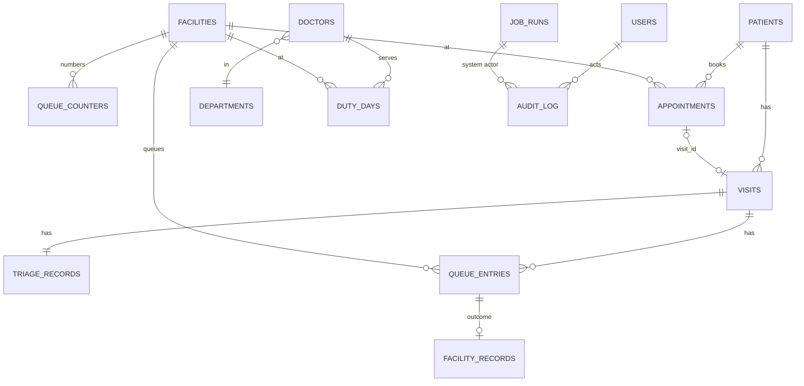

# Architecture Spine — Hospital OPD Management System

## Design Paradigm

The system is a **modular monolith**: one Next.js server process, split into **domain modules**, each layered the same way.

| Layer | Lives in | May call |
|---|---|---|
| UI (Server Components; Client Components only for interaction) | `src/app/**`, `src/components/**` | its own module's **actions** and **queries** |
| Actions (Server Actions) and read-only route handlers | `src/server/<module>/actions.ts`, `src/app/api/**/route.ts` | its own module's **service** / **queries** |
| Service (the domain rules and commands) | `src/server/<module>/service.ts` | its own **repository**; other modules' **services** and **queries** only |
| Queries (read-only, exported to other modules) | `src/server/<module>/queries.ts` | its own **repository** |
| Repository (Drizzle queries on the module's own tables) | `src/server/<module>/repo.ts` | `src/server/db` |

Modules: `auth`, `patients`, `visits`, `triage`, `queue`, `appointments`, `directory`, `settings`, `audit`, `jobs`, `overview` (read-only).



Module dependencies are one-way. The graph must stay acyclic.



## Invariants & Rules

### AD-1 — SQLite through Drizzle and better-sqlite3 on one server process [ADOPTED]
- **Binds:** all persistence; NFR-3, NFR-4
- **Prevents:** a second database or driver, serverless deployment that loses the file, schema drift from hand-run SQL, and queries running at build or prerender time.
- **Rule:**
  - One SQLite file, opened lazily on first use in `src/server/db`, with `journal_mode=WAL`, `foreign_keys=ON` and `busy_timeout=5000`.
  - Runs only under a single long-running `next start` process. No serverless or edge runtime for anything that touches the database.
  - Every query entry point runs at request time: it calls `requireStaff()`, `requireDisplayDevice()`, or `await connection()` first.
  - Schema changes happen only through `drizzle-kit` migrations committed to `drizzle/`.

### AD-2 — Modules own their tables
- **Binds:** all modules
- **Prevents:** two features writing the same table with different rules.
- **Rule:**
  - Each table has exactly one owner, shown below. Only the owner's `repo.ts` writes to it.
  - Other modules read it only through the owner's `queries.ts`, and change it only through the owner's `service.ts`. The only cross-table joins allowed are in the owner's repo and in `overview`.

| Owner | Tables |
|---|---|
| `auth` (Better Auth) | `users` (incl. role, facility assignments, `failed_attempts`, `locked_at`), `sessions`, `accounts`, `verifications`, `rate_limits` |
| `patients` | `patients`, `hospital_number_counters` |
| `visits` | `visits` |
| `triage` | `triage_records` |
| `queue` | `queue_entries`, `queue_counters`, `facility_records` (outcomes, Animal Bite Center and Prenatal fields) |
| `appointments` | `appointments` |
| `directory` | `departments`, `doctors`, `duty_days` |
| `settings` | `facilities`, `urgency_levels`, `priority_categories`, `clinical_schedules`, `opd_settings`, `display_devices` |
| `audit` | `audit_log` |
| `jobs` | `job_runs` |

### AD-3 — One command, one transaction, one audit row
- **Binds:** every mutation; PRIV-2, PRIV-6, FR-26
- **Prevents:** unaudited changes, half-applied commands, nested transactions silently becoming savepoints, and patient reads that are never logged.
- **Rule:**
  - **UI writes** go through a Server Action that:
    1. parses the input with the module's Zod schema;
    2. calls `requireStaff()`;
    3. calls `can(user, action, scope)` (AD-4);
    4. calls exactly one service **command**.
  - **Transactions:**
    - Only a command opens a transaction, and only through `withCommandTx(actor, action, fn)` in `src/server/db`. It always uses `db.transaction(fn, { behavior: "immediate" })`.
    - `fn` is synchronous: no `async`/`await`, because better-sqlite3 transactions are synchronous.
    - `tx` is passed down to repos, to other modules' service methods, and to `audit.record(tx, …)`.
    - Cross-module methods take `tx` and never open their own transaction.
  - **Audit:**
    - Each command writes exactly one `audit_log` row: actor, action, entity, entity id, time and changed fields. Action names come from the `AuditAction` enum in `src/server/audit`.
    - `audit_log` is append-only. SQLite triggers reject `UPDATE` and `DELETE` on it.
  - **Reads:**
    - Clinical and history reads go through `patients.getRecordView()`, which assembles data from the owners' `queries.ts` and writes a `patient.view` audit row.
    - No screen reads another module's clinical tables directly.
  - **Sanctioned exceptions:**
    - The Better Auth route handler writes its own tables (AD-9).
    - Scheduled jobs run as the `system` actor (AD-14).
    - Route handlers never write anything else.

### AD-4 — One permission map, enforced at the boundary
- **Binds:** FR-1–FR-3, FR-2 matrix, PRIV-1, PRIV-7
- **Prevents:** UI-only checks, and screens that disagree about what is allowed or for which Facility.
- **Rule:**
  - `src/server/auth/permissions.ts` is the single source for Role × action. For each action it also declares **which Facility is the scope**. It mirrors the PRD FR-2 table.
  - For Referral and follow-up booking, the scope is the **source** Queue Entry's Facility.
  - Actions and read handlers call `can()`, and hiding UI is cosmetic only.
  - The Display Board endpoint is the one exception, guarded by `requireDisplayDevice()` (AD-11).
  - `src/proxy.ts` only redirects signed-out users by reading the session cookie. It never queries the database.

### AD-5 — Queue numbers and "Call next" are serialized
- **Binds:** FR-8, FR-11, FR-12, NFR-4
- **Prevents:** duplicate Queue Numbers, and two staff calling the same patient.
- **Rule:**
  - Issuing a number increments `queue_counters(facility_id, opd_date)` inside the command's IMMEDIATE transaction (AD-3). `queue_entries` has `UNIQUE(facility_id, opd_date, seq)`, where `seq` is null for paper entries (AD-16).
  - `Call next` selects and updates the top Waiting entry in one IMMEDIATE transaction.
  - A Facility can have several counters.
    - Each Called or Serving entry stores `called_by` (the staff member) and `called_at`, and `called_at` is refreshed on every Recall.
    - `Call next` refuses (`DomainError("already_serving")`) while the caller has their own Called or Serving entry at that Facility.
  - Only the `queue` service changes `queue_entries.status`.
  - Vitest concurrency tests for FR-8 and FR-11 are required.

### AD-6 — Queue order and labels are snapshotted
- **Binds:** FR-9, FR-11, FR-14, FR-23, FR-24
- **Prevents:** order or labels changing when settings change, and screens that sort differently.
- **Rule:**
  - **At triage:** `triage_records` stores the priority snapshot (`urgency_level_id`, `urgency_rank`, `sort_group`, `priority_category`) once.
  - **On every Queue Entry** (first entry, Referral or restore), the entry copies that snapshot and also stores `prefix`, `seq`, `entered_at` and `call_count`.
    - For a Referral, `entered_at` is the referral time.
    - A restored No-show keeps its original `entered_at`.
  - **Sorting:** every queue read orders by `sort_group, urgency_rank, entered_at`, through one `queue` repo function. It filters with the shared `liveQueue` predicate: today's `opd_date`, status in (waiting, called, serving), not a paper entry.
  - **Labels:** `formatQueueNumber(prefix, seq)` uses only stored columns.

### AD-7 — One clock: UTC storage, Manila OPD day, stored explicitly
- **Binds:** FR-8, FR-12, FR-17, FR-18, FR-21, FR-23, FR-25, SM-*
- **Prevents:** rows filed under different days depending on which timestamp a reader derives the day from.
- **Rule:**
  - Timestamps are stored as UTC ISO-8601 text.
  - Every day-scoped table (`visits`, `queue_entries`, `queue_counters`, `appointments`, `job_runs`) has an `opd_date` column (`YYYY-MM-DD`, Asia/Manila). The owner writes it once at creation using `opdDate(instant)` from `src/lib/time.ts`. For paper entries it is the real date.
  - Queries filter on `opd_date` and never derive it at read time.
  - Better Auth tables are the one exception: they keep the library's integer timestamps.

### AD-8 — Policy lives in settings tables
- **Binds:** FR-7, FR-9, FR-11, FR-15, FR-23, FR-24, PRD §10
- **Prevents:** hard-coded Facilities, Urgency Levels, Priority Categories, schedules or thresholds, and pilot state kept in two places.
- **Rule:** these are rows in `settings`-owned tables, read only through `settings` getters (`liveFacilities()`, `urgencyLevels()` and so on):
  - Facilities: prefix, hours, days and `is_live` for the pilot;
  - Urgency Levels: name, rank and ER flag;
  - Priority Categories: enabled flag and legal basis;
  - Animal Bite Center dose schedules;
  - the prenatal target;
  - the No-show call threshold;
  - the pre-close warning offset.

  Seed migrations insert the PRD defaults.

### AD-9 — Staff authentication with Better Auth
- **Binds:** FR-1, FR-3, PRIV-7
- **Prevents:** a second session mechanism, shared or impersonated accounts, sessions that never idle out, and lockout confused with deactivation.
- **Rule:**
  - **Library and plugins:** Better Auth with the Drizzle adapter and the `username()` and `admin()` plugins. Admin impersonation is disabled.
  - **Sessions:** stored in the database with `expiresIn: 900` and `updateAge: 60`. There is no `cookieCache`.
  - **Polling:** polling reads call `getSession({ query: { disableRefresh: true } })`, so background polling never keeps an idle session alive.
  - **Lockout:** a `hooks.after` on `/sign-in/username` counts `failed_attempts` and sets `locked_at` at 5. Admins clear it (FR-3). `banned` is reserved for deactivation.
  - **Rate limiting:** `rateLimit` uses database storage.
  - **Current user:** role and Facility assignments are fields on `users`. Server code gets the current user only through `requireStaff()`.
  - **Audit:** sign-in, sign-out, lockout and unlock are audited from Better Auth hooks.

### AD-10 — Live data by polling
- **Binds:** FR-10, FR-16, FR-21, NFR-2
- **Prevents:** a mix of push mechanisms, stale queue screens, and polling that defeats the idle timeout.
- **Rule:**
  - Live screens (Facility Queue, Display Board, Overview tiles) poll read-only route handlers every 3 seconds with TanStack Query (`refetchInterval`). Query keys come from one factory per module in `src/lib/query-keys.ts`.
  - Mutations use `useMutation` → Server Action, then invalidate the affected keys.
  - Polling handlers never refresh sessions (AD-9).
  - Nothing else pushes data: no SSE and no WebSockets.

### AD-11 — The Display Board is isolated and anonymous
- **Binds:** FR-16, FR-27, PRIV-1
- **Prevents:** patient data reaching the waiting-area screen.
- **Rule:**
  - The Display Board is the `(display)` route group, with no app shell and no staff session.
  - `requireDisplayDevice()` checks an httpOnly device-token cookie against an active `display_devices` row.
  - The endpoint returns `DisplayBoardDTO`, built only from `queue/queries.ts`. It contains Facility name and prefix, and Queue Numbers with their status and `calledAt`. `calledAt` is non-personal and lets the board detect a new call or a Recall. The type allows no other fields.
  - An unregistered device gets a pairing code, and an Admin registers it by that code (FR-27).

### AD-12 — Data protection at rest, in transit and over time
- **Binds:** PRIV-3, PRIV-5, NFR-3
- **Prevents:** unencrypted copies of the database, lost data, and hard deletion.
- **Rule:**
  - The SQLite file and its backups live only on OS-encrypted volumes (e.g. BitLocker).
  - HTTPS ends at a reverse proxy in front of `next start`.
  - A nightly `VACUUM INTO` backup (the AD-14 job) goes to a separate disk and keeps 30 daily files.
  - Patient data is never hard-deleted; records get `deactivated_at` instead.

### AD-13 — The Visit has one owner
- **Binds:** FR-7, FR-8, FR-13, FR-14, FR-18, FR-25, UJ-4, UJ-5
- **Prevents:** triage, queue and appointments each deciding when a Visit ends, and the Appointment–Visit link stored twice.
- **Rule:**
  - The `visits` module owns `visits` and the stored `VisitStatus`.
  - `triage` creates a Visit with `visits.open(tx, …)`.
  - `queue` reports every terminal Queue Entry with `visits.onEntryTerminal(tx, entry)`, and `visits` alone decides the Visit's status.
  - The only link to an Appointment is `appointments.visit_id`. It is set by `appointments.checkIn(tx, …)`, which starts the Visit through `visits.open`.

### AD-14 — Scheduled work runs as system commands
- **Binds:** FR-12, FR-18, FR-23, NFR-3, AD-12 backups
- **Prevents:** every epic inventing its own timer, jobs writing without an audit trail or through a fake staff account, and duplicate runs.
- **Rule:**
  - A single in-process scheduler in the `jobs` module is started once from `src/instrumentation.ts` `register()`.
  - Each job is a normal service command, run through `withCommandTx` with `actor = system`.
  - Jobs are idempotent: a `job_runs(job, key)` unique row, e.g. `facility-close:<facility>:<opd_date>`. On startup the scheduler catches up any missed keys.
  - The jobs are:
    - **facility close** at each Facility's closing time: cancels Waiting and Called entries through the `queue` service; `visits` then finalizes;
    - **appointments missed** after the last closing;
    - the **pre-close warning** flag;
    - the **nightly backup**.

### AD-15 — Status changes follow declared state machines
- **Binds:** FR-8, FR-11–FR-14, FR-17, FR-18
- **Prevents:** modules applying different or skipped transitions, and one status union reused across entities.
- **Rule:**
  - `QueueStatus`, `VisitStatus` and `AppointmentStatus` are separate unions, each with its own transition table in its owner's `schema.ts` and a CHECK constraint.
  - The owner's service is the only code that changes a status, and only along a declared transition. Anything else throws `DomainError("invalid_transition")`.

### AD-16 — Paper back-entry stays out of live queues
- **Binds:** FR-25, NFR-3
- **Prevents:** back-dated entries using counters, appearing on today's queues, or skipping transitions ad hoc.
- **Rule:**
  - Paper Visits are created through `visits.open` with `entered_from_paper = 1` and the real `opd_date`.
  - Their queue record comes from `queue.recordPaperEntry()`. It takes no counter `seq`, stores the handwritten number as `paper_number` text, and is created directly in a terminal status. That is a declared transition for paper entries only.
  - `liveQueue` excludes paper entries.

## Consistency Conventions

| Concern | Convention |
| --- | --- |
| Naming | Tables `snake_case` plural (`patients`, `queue_entries`); columns `snake_case`; TS types `PascalCase` singular (`Patient`, `QueueEntry`); files `kebab-case`; PRD Glossary terms verbatim in code (`urgencyLevel`, not `acuity`) |
| IDs | Primary keys: text UUIDs (`crypto.randomUUID()`). Hospital Number `HN-YYYY-NNNNNN` from `hospital_number_counters` in the patient-creation transaction. Queue Number shown only via `formatQueueNumber(prefix, seq)` → `PN-004` |
| Dates | UTC ISO-8601 text; `opd_date` columns (AD-7); display with shared `Intl` formatters using `timeZone: "Asia/Manila"` |
| Enums | One union per entity (AD-15), stored as lowercase text with CHECK; e.g. QueueStatus `waiting`, `called`, `serving`, `completed`, `referred`, `no_show`, `cancelled` |
| Validation | Zod 4 schemas per module in `schemas.ts`, shared by forms and actions; `safeParse` only |
| Action results | `{ ok: true, data } \| { ok: false, error: { code, message, fieldErrors? } }`; expected failures never throw to the client |
| Errors | Services throw `DomainError(code)`; actions map it to results; unexpected errors reach `error.tsx` without patient data |
| Audit rows | `id, at, actor_type (staff/system), actor_id, action (AuditAction enum), entity, entity_id, changes (JSON of changed fields)`; one per command (AD-3) |
| Server-only code | Every file under `src/server/**` starts with `import "server-only"` |
| Logging | App logs never contain patient names, complaints or Hospital Numbers; the audit log is the record of who did what |
| UI | Keep the story 1.5 shell and tokens; list pages use the story 1.4 URL-driven table pattern. The route group `(dashboard)` is renamed to `(staff)` |
| Tests | Vitest service tests against a temp-file SQLite migrated fresh per test file; required for queue ordering, numbering, concurrency, permissions and state machines |

## Stack

Verified against npm and shipped package code on 2026-09-26.

| Name | Version |
| --- | --- |
| Node.js | 24.x (better-sqlite3 13 requires ≥ 22; prebuilt win32-x64 binaries confirmed) |
| Next.js (App Router) | 16.3.6 [ADOPTED] |
| React / React DOM | 19.2.8 [ADOPTED] |
| TypeScript | 5.x [ADOPTED; 7.0 not adopted yet] |
| Tailwind CSS / shadcn/ui (radix-nova) | 4.x / CLI 4.21.0 [ADOPTED] |
| better-sqlite3 (bundled SQLite 3.53.4) | 13.0.3 |
| @types/better-sqlite3 | 9.6.0 |
| Drizzle ORM / drizzle-kit | 0.45.3 / 0.31.11 (exact pins; 1.0 is still an RC) |
| Better Auth | 1.7.6 |
| TanStack Query | 5.104.0 |
| Zod | 4.6.5 |
| Vitest | 5.0.2 (needs `@types/node` ^24; bump from ^20) |

## Structural Seed





```text
src/
  app/
    (auth)/sign-in/        # sign-in page
    (staff)/               # app shell (story 1.5): overview, triage, queues/[facility], patients, appointments, directory, admin/*
    (display)/board/       # Display Board, no shell (AD-11)
    api/                   # read-only polling handlers (AD-10), /api/auth/[...all] (Better Auth), /api/health
  components/              # UI; ui/ = shadcn
  server/
    db/                    # lazy connection, withCommandTx, schema index, migrate, backup
    auth/                  # Better Auth config, requireStaff, permissions (AD-4, AD-9)
    <module>/              # schema.ts, repo.ts, service.ts, queries.ts, actions.ts, schemas.ts
  lib/                     # time.ts (AD-7), formatters, query-keys.ts
  instrumentation.ts       # starts the jobs scheduler (AD-14)
  proxy.ts                 # optimistic sign-in redirect only (AD-4)
drizzle/                   # migrations + seed of PRD defaults (AD-8)
scripts/                   # create-admin, seed-demo, backup/restore helpers
```

## Operations

| Concern | Decision |
| --- | --- |
| Environments | `development` (local file `data/dev.sqlite`, demo seed allowed), `test` (temp files per test run), `production` (hospital server) |
| Config | `.env` contract: `DATABASE_PATH`, `BACKUP_DIR`, `BETTER_AUTH_SECRET`, `BETTER_AUTH_URL`, `NODE_ENV`. The app refuses to start in production if any is missing. Secrets are never committed (`.env*` is already git-ignored) |
| Deploy order | `npm ci`, then `npm run build`, then `npm run db:migrate`, then restart `next start`. `db:migrate` first takes a `VACUUM INTO` pre-migration backup |
| First run | `npm run create-admin` (CLI) creates the first Admin account; there is no default password |
| Demo and training data | `npm run db:seed:demo` loads fictional patients and visits. It refuses to run when `NODE_ENV=production` |
| Health | `GET /api/health` returns DB reachability, the last successful backup, and the last run of each job, with no patient data |
| Backups and restore | Nightly job (AD-12, AD-14). A documented restore drill is run before go-live and quarterly |

## Capability → Architecture Map

| Capability / Area | Lives in | Governed by |
| --- | --- | --- |
| Sign-in, roles, staff accounts (FR-1–3) | `server/auth`, `(auth)`, `(staff)/admin/staff` | AD-4, AD-9 |
| Patients, privacy-notice consent (FR-4–6, PRIV-4) | `server/patients` (consent timestamp on `patients`), `(staff)/patients` | AD-2, AD-3, story 1.4 table pattern |
| Visits (lifecycle) | `server/visits` | AD-13, AD-15 |
| Triage + issue number (FR-7, FR-8) | `server/triage` → `visits`, `queue` | AD-3, AD-5, AD-6, AD-8 |
| Queues, call/serve, No-show (FR-9–11) | `server/queue`, `(staff)/queues/[facility]` | AD-5, AD-6, AD-10, AD-15 |
| Daily reset and closing (FR-12, FR-23) | `server/jobs` → `queue`, `visits` | AD-7, AD-14 |
| Outcomes, Referral, follow-up, Animal Bite Center and Prenatal fields (FR-13–15, FR-22) | `server/queue` (`facility_records`) → `appointments` | AD-2, AD-3, AD-4 (source scope), AD-8 |
| Display Board + devices (FR-16, FR-27) | `(display)/board`, `api/display`, `server/settings` | AD-10, AD-11 |
| Appointments (FR-17, FR-18) | `server/appointments` | AD-7, AD-13, AD-14, AD-15 |
| Directory + duty days (FR-19, FR-20) | `server/directory` | AD-2 |
| Overview (FR-21) | `server/overview` (read-only joins) | AD-2, AD-7, AD-10 |
| Settings (FR-23, FR-24) | `server/settings` | AD-8 |
| Paper back-entry (FR-25) | `server/visits` + `queue.recordPaperEntry` | AD-16 |
| Audit log (FR-26, PRIV-2) | `server/audit` | AD-3 |
| Encryption, backup, retention (PRIV-3, PRIV-5) | deployment, `server/jobs` | AD-12, Operations |

## Deferred

- **Push updates (SSE or WebSockets):** polling meets the 5-second target (NFR-2). Revisit if load or latency needs it.
- **SQLCipher or column-level encryption:** volume encryption covers PRIV-3 on one server. Revisit if the DPO requires file-level encryption.
- **Scaling beyond one server, and a move to Postgres:** SQLite and one process fit one hospital's OPD. Revisit for a second site or high availability. Drizzle keeps the path open.
- **Host OS, process supervisor and reverse proxy product:** any Node 24 host with an encrypted volume that auto-restarts `next start` (e.g. a Windows service wrapper or systemd) satisfies AD-1 and AD-12. The hospital's IT and DPO choose (PRD Open Question 4). The first deploy story documents the chosen setup.
- **Monitoring and alerting beyond `/api/health`:** decided with hospital IT at deployment.
- **Printing Queue Number slips:** browser print of a slip route for now; receipt printer drivers later.
- **Reporting and exports (DOH, NaRIS, PhilHealth):** out of MVP scope (PRD §8.2).
- **Removing the Acme Store code:** the first epic's first story does it (store routes, sample data, `orders-*`, the unbuilt story 1.3).
